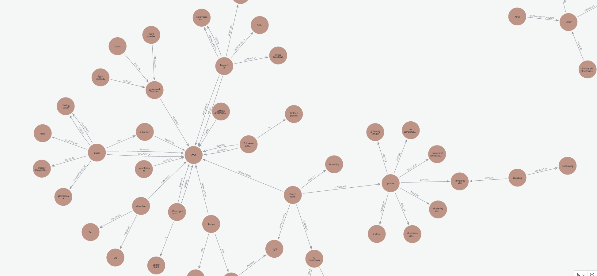
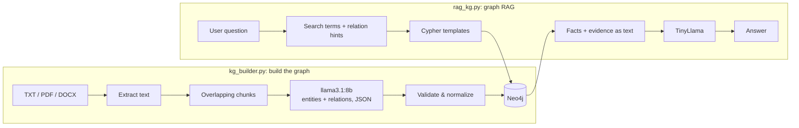
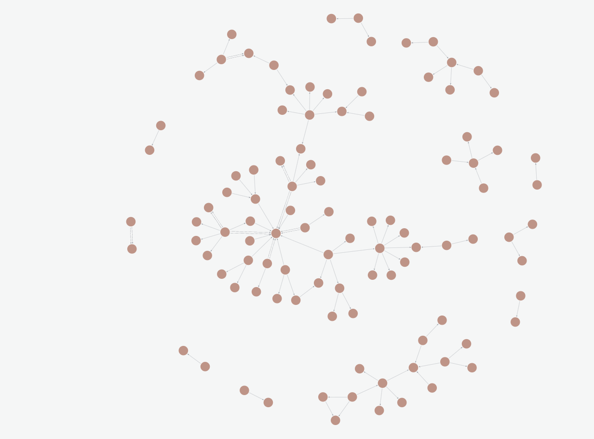

# Neo4j Knowledge Graph + Graph RAG

Build a knowledge graph from a folder of documents with a **local LLM** (Ollama, `llama3.1:8b`), store it in **Neo4j** with full source/evidence tracking, then use it as retrieval context for question answering with **TinyLlama**. Everything runs locally; no cloud API or key is needed.

Built for Week 12 of **IE 7722 Agentic AI Systems (LSU, Fall 2026)**. The companion project (LoRA fine-tuning + MCP weather agent) is
[tinyllama-medical-lora](https://github.com/SAeidch/tinyllama-medical-lora).


*Largest cluster of the graph extracted from five indoor-air / green-wall papers: plants, substrates and green walls `REMOVE` or `DRAW_DOWN` CO2.*

---

## Pipeline



**`kg_builder.py`** (the 7 steps)

1. Read the corpus folder recursively (`.txt`, `.pdf`, `.docx`).
2. Extract text: UTF-8 for TXT, PyMuPDF page by page for PDF, python-docx (paragraphs + tables) for DOCX.
3. Chunk into windows of `--chunk-size` characters sharing `--overlap` characters; each chunk ends on a paragraph, sentence or word boundary.
4. Send each chunk to `llama3.1:8b` in JSON mode at temperature 0, with a per-call timeout and output-token cap (a failing chunk is skipped, not fatal).
5. Validate and normalize: case-insensitive names, a fixed entity-type list, `UPPER_SNAKE_CASE` relations, entities must literally appear in the chunk, relations need in-chunk evidence, self-loops and duplicates removed.
6. `MERGE` entities and relations into Neo4j, so the same entity from different chunks or documents becomes one node.
7. Keep provenance: `(Document)-[:HAS_CHUNK]->(Chunk)-[:MENTIONS]->(Entity)`, and every entity-to-entity edge stores `evidence` (`[document | chunk] sentence`) and `sources`.

**`rag_kg.py`**: no LLM writes Cypher. TinyLlama is too small to do it reliably, so the queries are fixed templates and only the **parameters** come from the question:

1. **Search terms:** lower-case, drop stop words and generic words, trim plurals ("How do plants remove CO2 from indoor air?" → `plant, co2, indoor, air`).
2. **Relation hints:** verbs that match relation types (remove, affect, contain, author, ...) are kept to rank edges, not to find entities.
3. **Query 1** finds entities whose name contains a term (ranked by terms matched, then degree; `--ranking specific` puts exact and rare-term matches first). **Query 2** pulls the relations around them with evidence and sources. **Query 3** (fallback) searches raw chunk text when no relation is found.
4. Results become lines like `indoor plants --reduce--> CO2. Evidence: "..." [S2]`, capped at 12 facts / 3,000 characters to fit TinyLlama's 2,048-token window, and are placed above the question with an "answer only from the context" instruction.

All values are passed as Cypher parameters, never pasted into query text. Every step (terms, queries, parameters, rows, context, exact prompt, answer) is logged to `rag_log.txt`; see [`examples/rag_log_example.txt`](examples/rag_log_example.txt).

---

## Setup

1. Install [Ollama](https://ollama.com/download) and [Neo4j Desktop](https://neo4j.com/download/) (or Community Edition). Create a local instance and note its URI, user and password.
2. Pull the models:
   ```powershell
   ollama pull llama3.1:8b
   ollama pull tinyllama
   ```
3. Python environment:
   ```powershell
   python -m venv .venv; .\.venv\Scripts\Activate.ps1
   pip install -r requirements.txt
   ```
4. Credentials go in environment variables, **never in code**:
   ```powershell
   $env:NEO4J_PASSWORD = "<your password>"
   # optional: $env:NEO4J_URI = "neo4j://127.0.0.1:7687"; $env:NEO4J_USER = "neo4j"
   ```
5. Put your documents in [`corpus/`](corpus/) (git-ignored), or point `--corpus` / `KG_CORPUS_DIR` at another folder.

## Run

```powershell
# Build the graph (Neo4j and Ollama must be running)
python kg_builder.py --clear                                  # defaults: chunk 1000, overlap 150
python kg_builder.py --clear --chunk-size 500 --overlap 50
python kg_builder.py --clear --max-docs 3 --max-chars 15000   # quick, small run
python kg_builder.py --resume                                 # continue an interrupted run

# Ask questions against the graph
python rag_kg.py "What affects indoor temperature?"
python rag_kg.py --compare "Who wrote about green wall technology?"   # also answer WITHOUT context
python rag_kg.py                                                       # interactive
```

---

## Results: effect of chunk size

Same 5 papers, same model and validation rules, graph cleared between runs:

| Chunk size / overlap | Chunks | Entities | Relationships | Time | Relationships per entity | Concept share | Person share |
|---|---|---|---|---|---|---|---|
| 500 / 50 | 286 | 761 | 602 | 30.2 min | 0.79 | 41% | 14% |
| 1000 / 150 | 149 | 603 | 411 | ~27 min | 0.68 | 30% | 17% |
| 3000 / 300 | 48 | 241 | 144 | 15.2 min | 0.60 | 15% | 32% |

- **Large chunks (3000) lose technical content.** The 8B model returned about 5 entities per 3,000-character chunk. Concept nodes fell 79% vs. 1000/150 while Person nodes fell only 25%, so authors and citations dominated the graph.
- **Small chunks (500) recover detail but add noise.** Concepts were 41% of entities, and domain relations (`AFFECTS`, `REMOVES`, `CONTAINS`) came back, but table captions and citations became hub nodes and some edge directions were reversed. 44% of extracted entities were duplicates merged on write.
- **Recommendation:** 1000/150 as a default; 500/50 when fine detail matters. These judgments come from inspecting the graphs, not from a gold-standard graph.


*Overview at 1000/150: many small clusters around a few hubs. Chunks connect only when they produce the same normalized entity name.*

## Results: graph RAG with TinyLlama

| Question | Relevant facts retrieved? | Answer with graph context | Answer without context |
|---|---|---|---|
| How do plants remove CO2 from indoor air? | Partly (1 of 8) | Generic, mostly not from context | Generic, with an error |
| What affects indoor temperature? | Yes (plus noise) | Wrongly says context has no answer | Generic list |
| What is a green wall and what does it contain? | Yes | Contradictory, partly from context | Generic description |
| Who wrote about green wall technology? | No | **Correct abstention** | **Hallucinated** author and journal |
| What is the capital of France? | Nothing (expected) | Paris, ignoring the "context only" rule | Paris |

The graph's clearest benefit was **grounding**: with nothing relevant retrieved, the model said "I don't know" instead of inventing an author. The weak points were name-only entity matching and the 1.1B generator, which often ignored good context. A larger local model and embedding-based entity matching are the obvious next steps.

## Limitations

- Experiments used 5 of 65 papers, one run per configuration, and judgments by inspection (no precision/recall against a reference graph).
- Front matter and citations produce Person/Organization nodes unrelated to the technical content.
- The source papers are not redistributed here; bring your own corpus.

## Security

No credentials are stored in this repository. The Neo4j password is read from `NEO4J_PASSWORD` at run time (the in-code default is the placeholder `YOUR_PASSWORD_HERE`). `.gitignore` blocks `.env*`, key files, the corpus folder, run logs and Office documents.
